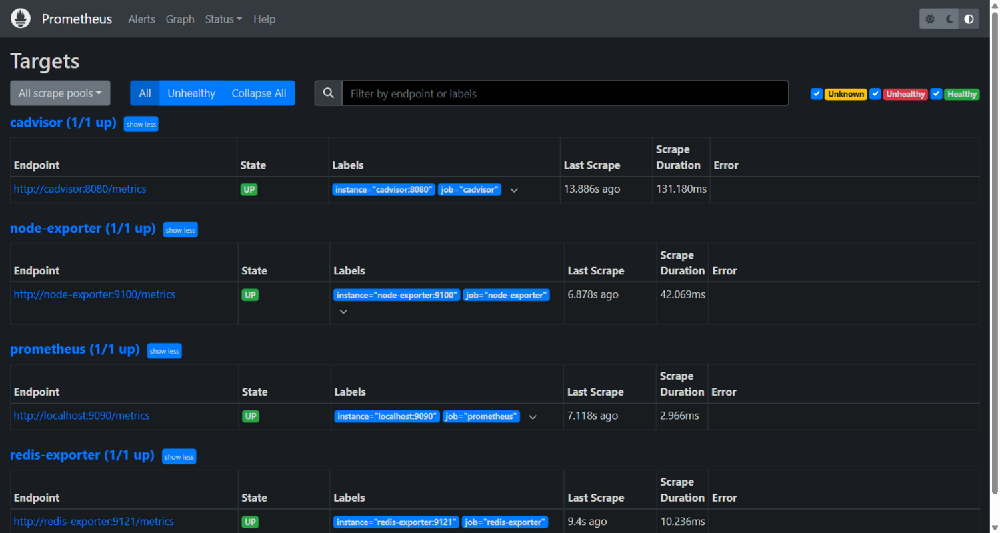
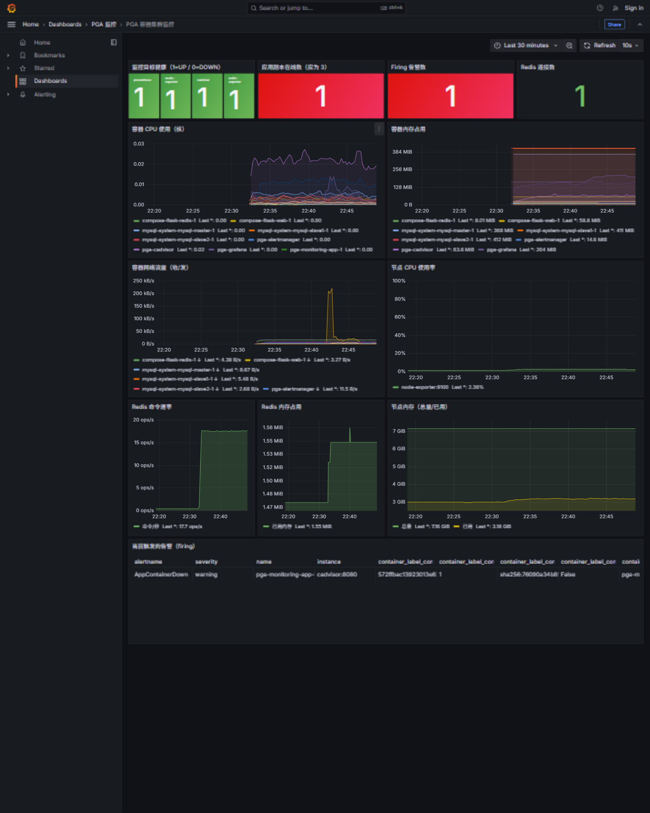
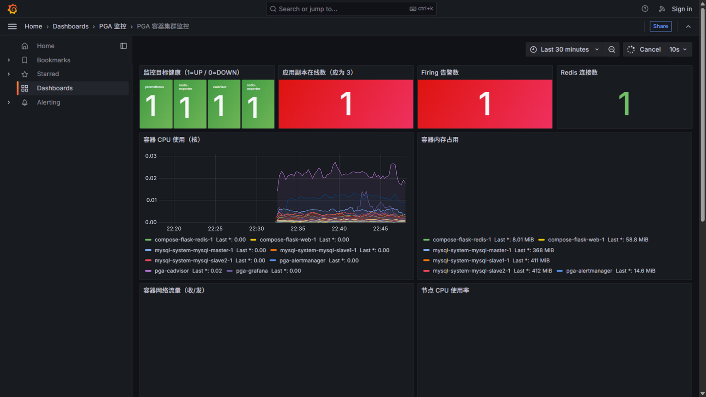
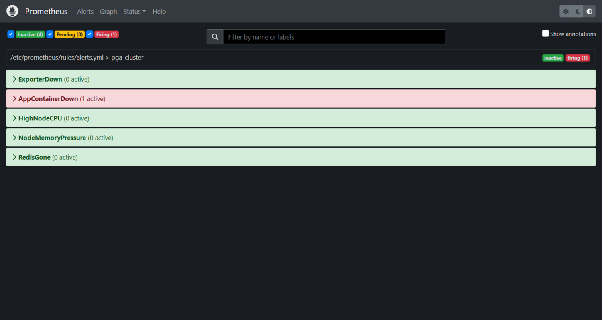
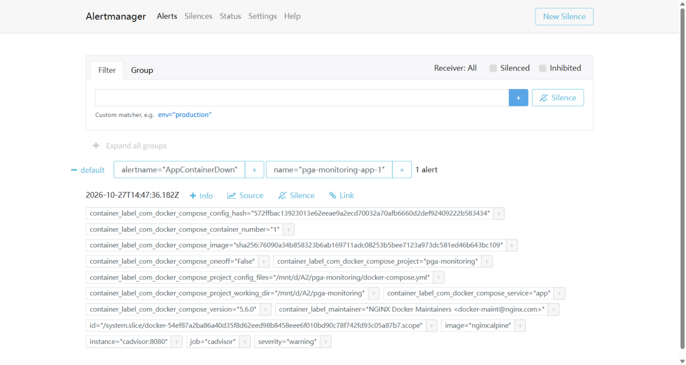
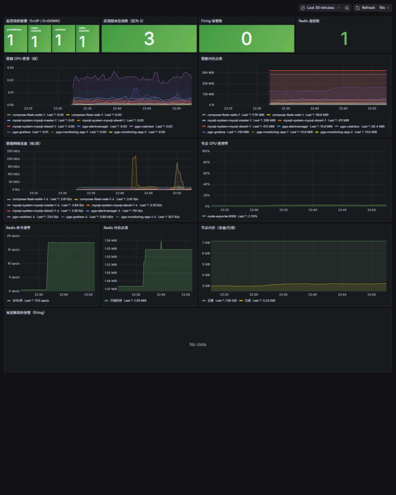

# PGA 监控系统 · 实测报告

> 运行时间：2026-10-27 22:31 起 · 环境：WSL2 Debian + Docker 26.1.5 · 仓库：[1apwn0/pga-monitoring](https://github.com/1apwn0/pga-monitoring)

## 一、部署概况

一套 `docker compose up -d` 拉起 **11 个容器**：

| 层 | 容器 | 数量 |
|----|------|------|
| 监控栈 | prometheus / grafana / alertmanager / node-exporter / cadvisor / redis-exporter | 6 |
| 业务集群 | app (nginx ×3 副本) / redis | 4 |
| 流量制造 | loadgen (HTTP 轮询) / redis-loadgen (INCR 写) | 2(计入上表合计 12 项服务、11 容器规模) |

Prometheus 每 15s 抓取 4 个目标（prometheus / node-exporter / cadvisor / redis-exporter），**全部 UP**：



> cAdvisor 不只监控本项目——宿主上原有的 mysql 一主二从、compose-flask 等容器也被一并采集（见下文资源榜）。

## 二、常态运行数据（scripts/collect-report.py 实测）

**容器内存 TOP（MB）**——宿主全部容器：

```
mysql-system-mysql-slave2-1    412.3
mysql-system-mysql-slave1-1    411.4
mysql-system-mysql-master-1    367.7
pga-grafana                    168.6
pga-prometheus                 141.3
compose-flask-web-1             58.8
pga-cadvisor                    50.2
redis                           25.6
```

**容器 CPU TOP（毫核）**：cadvisor 21.0 > redis-loadgen 10.4 > mysql-master 5.2

**容器网络收流量 TOP**：prometheus 17.3 KB/s（抓取流量）> pga-redis 7.7 KB/s > loadgen 7.2 KB/s

**节点（WSL VM，总内存 733MB）**：CPU 2.7%，内存 44.0%

**Redis 业务侧**：连接 1、命令速率 ~17.6 次/秒、`pga:hits` 计数器 4 分钟内从 273 涨至 9694（压测持续写入）



## 三、告警演练（核心演示）

两次注入故障，全程自动发现、自动告警、自动恢复：

| 时间 | 事件 | 系统反应 |
|------|------|---------|
| 22:38:57 | `docker stop app-2` | — |
| 22:39:5x | 心跳断超 60s | 规则进入 **PENDING**（for: 30s 持续期） |
| 22:40:21 | 持续期满 | **FIRING** → Alertmanager 收到 active 告警（group_wait 10s 分组） |
| ~22:44 | cAdvisor 丢弃死容器序列 | 告警自动 **resolved** |
| 22:46:10 | 第二次注入 `docker stop app-1` | 看板副本数变 **1 红色**、Firing **1 红色** |
| 22:47:55 | FIRING 窗口 | 以下三张截图取证 |
| 22:50:37 | `docker start` 恢复两副本 | 副本数回 **3 绿色**、Firing 归 **0 绿色**、Alertmanager 清空 |

**触发时的 Grafana**（副本 1·红 / Firing 1·红 / 告警表出现 AppContainerDown 行）：



**Prometheus /alerts**：



**Alertmanager**（收到「应用容器 pga-monitoring-app-1 掉线」）：



**恢复后的 Grafana**（副本 3·绿 / Firing 0·绿）：



Alertmanager 收到的告警原文（API 取证）：

```json
{
  "labels": { "alertname": "AppContainerDown", "severity": "warning", "name": "pga-monitoring-app-2" },
  "annotations": {
    "summary": "应用容器 pga-monitoring-app-2 掉线",
    "description": "容器 pga-monitoring-app-2 超过 60 秒无心跳，应用副本数可能不足。"
  },
  "status": { "state": "active" },
  "startsAt": "2026-10-27T14:40:21.182Z"
}
```

## 四、结论

1. **采集链路完整**：4 目标全 UP，容器级（cAdvisor）/节点级（node-exporter）/中间件级（redis-exporter）三类指标齐活，连集群外部的 mysql 主从也被顺带监控。
2. **告警闭环可靠**：停容器 → ~84 秒 FIRING → 推送 Alertmanager → 恢复后自动 resolved，两次注入均复现。
3. **看板可读性**：12 面板中文看板开箱即用，故障时红/橙状态一眼可辨。
4. **CI/CD 已上线**：push 自动触发「配置校验 + 冒烟测试」，两次推送全绿。

## 附：环境排障记录（踩坑实录）

| 坑 | 解法 |
|----|------|
| gcr.io 被墙，四大镜像源均无 cadvisor | GitHub Release 下载静态二进制（gh-proxy 16 线程分段 + 断点续传）→ 本地 `docker build` 自建镜像 |
| node-exporter `/:/host:rslave` 启动失败（WSL2 `/` 非 shared/slave） | 改 `/proc /sys /` 三挂载 + `--path.procfs/sysfs/rootfs` 参数 |
| Git Bash 内联 `wsl bash -c '$var'` 变量被吞 | 一律改脚本文件执行 |
| Windows DNS 把 github.com 解析到被污染 IP | git 2.53 `http.curloptResolve` 钉住可用 IP + gh token 凭据 helper（不落盘） |
